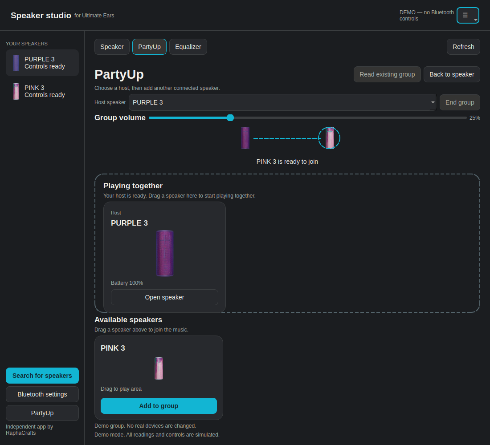

<div align="center">

# Speaker studio
### Your Ultimate Ears speakers, on Linux.

A simple desktop app for checking your speaker, adjusting its sound, and keeping
your music setup in one place.

**No account. No Python installation. No terminal needed to get started.**

[Download the AppImage](https://github.com/RaphaCrafts/Linux-Ultimate-Ears/raw/refs/heads/main/downloads/Speaker-Studio-x86_64.AppImage)

</div>


## Get started

1. **Download** the AppImage using the button above.
2. **Allow it to run.** Right-click the downloaded file, open **Properties →
   Permissions**, and enable **Allow executing file as program** (your desktop
   may call this **Executable as Program**).
3. **Double-click** the AppImage to open Speaker studio.
4. Turn on your speaker and pair it in your desktop's **Bluetooth settings**.
5. Choose your speaker in the app and click **Connect**.

Keep the AppImage wherever you like. On first launch, Speaker studio adds a
shortcut to your app menu with its blue icon; no administrator password is needed.
If you move the file, open it once from its new location to update the shortcut.
The current download is for **64-bit Intel/AMD Linux PCs**, with **Ubuntu 24.04,
Zorin OS 18, or newer** as the baseline. ARM computers are not supported yet.

## What you can do

- See your speaker's battery, connection and current volume.
- Detect known BOOM 3 / MEGABOOM 3 finishes and remember their artwork while offline.
- Rename a connected speaker using **Rename**; the new name is stored on the speaker.
- Use the blue icon in your taskbar and system tray.
- Adjust speaker volume without reaching for your phone.
- Choose a sound profile or adjust five custom EQ bands.
- Power off the speaker, then find and wake compatible sleeping speakers over BLE.
- Find your speaker by asking it to announce its battery level.
- Choose from 39 official speaker colour images, or use a neutral **Generic**
  illustration if your finish isn’t listed.
- Keep several connected speakers visible in one app.
- Use the **PartyUp preview** to add or remove compatible connected speakers.

## Sleeping speakers and PartyUp

**Search for speakers** scans for both regular Bluetooth devices and low-energy
signals from sleeping speakers. For a compatible paired speaker nearby, select
it and click **Turn on**. **Connect controls** also checks for a sleeping speaker
and wakes it when a supported signal is available. The app verifies that the speaker responds before
reporting that it is on. Remote wake was tested with a real MEGABOOM 3.

Bluetooth Smart / remote power must be enabled on the speaker (use the phone app
if necessary), Bluetooth must be on, and the speaker must have battery power.
Deep sleep, disabled BLE, unsupported models or an unrecognized advertisement
cannot be woken. If Turn on is unavailable, search again or use its power button.
Search does not automatically turn on every speaker it finds.

Clicking a speaker always returns to its main controls. **Back to speaker** also
leaves the PartyUp page, even with Bluetooth disconnected. Losing the connection
clears stale group controls and cancels pending group actions. A group can keep
playing on the speakers after your computer disconnects; reconnect to use
**End group**. “Saved · disconnected” means Linux remembers the pairing, not that
the speaker is connected or still in a PartyUp group.

## Colours and the system tray

Choose **Automatic** under **Speaker finish** to use the colour reported by the
speaker. Known BOOM 3 and MEGABOOM 3 colours are mapped to matching artwork.
Unrecognized or unsupported colours use a neutral Generic illustration; you can
choose any finish manually without changing the speaker. Your selection is saved.
The last detected colour and model are saved separately for each speaker, so the
artwork stays correct after restarting the app or renaming the speaker. Manual
finish choices take priority. Colour detection needs a control connection and does not identify every limited
edition or later-generation speaker.

The tray menu has **Show Speaker studio**, **Hide window**, and **Quit**. Hiding
keeps the app connected; closing the window or choosing Quit exits the app.
Tray availability depends on your desktop. If a tray is unavailable, keep the
app minimized in the taskbar instead.

This is the **first preview release**, focused on **MEGABOOM 3 and BOOM 3**.
MEGABOOM 3 has been tested with a real speaker. Other models and every firmware
version have not been tested. **PartyUp is experimental:** its join/remove
logic is implemented and automatically tested. Balance commands have been
read back on a real MEGABOOM 3 pair; that alone does not confirm an audible change.
Use **Read existing group** in PartyUp to reconnect controls to the speaker
playing audio from Linux. You do not need a separate control connection to its
group receiver. Member details may remain pending until the host sends an update;
the app distinguishes this from a confirmed empty group. Alarms and direct firmware installation are not included yet.

PartyUp runs on the speakers and continues after quitting Speaker studio. Use
**End group** to stop it. In listening tests, one MEGABOOM 3 played smoothly while
the pair stuttered even with all control apps closed. This remains unresolved;
the corrected receiver channel in this release is not a confirmed audio fix.

In **PartyUp**, drag a ready speaker from **Available speakers** into the dashed
**Playing together** area. You can also click **Add to group**. The speaker shows
**Joining…** until the host confirms it is playing; any error appears above the
controls. The active host is selected automatically, and a confirmed receiver
appears as **In PartyUp** even without its own control connection.
A subtle animation highlights ready speakers and shows the connection in progress.



The preview above uses simulated devices. With **two speakers**, click the **Stereo** button
under **Playback mode** (host left, member right), then drag the **balance** slider toward
either speaker to give it more emphasis; **Centre** restores equal emphasis.
The **Double Up** button makes both speakers play the full sound and disables stereo balance.
The app checks that the speaker actually switched mode before enabling balance.
The group volume control keeps that balance.
Balance previews move immediately; the app sends your final position after you
release the slider and pause briefly. Quick adjustments are combined so older
readings do not interrupt your next adjustment.

With **three or more speakers**, each card has a vertical volume slider. Click
**Refresh speaker levels** to load levels for receivers without a direct control
connection. A slider becomes available only after the speaker confirms its level.
Some firmware versions do not expose individual receiver levels; those sliders
stay unavailable, while group volume remains usable. Changing group volume
synchronizes the speakers' volumes. Larger groups have not been hardware tested.

The launcher uses the blue Speaker studio icon directly, including on desktops
with an outdated icon cache. Launch this updated AppImage once to update its
app-menu shortcut, then use that shortcut to pin it to the taskbar.

BOOM 4, MEGABOOM 4, EVERBOOM, EPICBOOM, HYPERBOOM and
WONDERBOOM are not supported for control in this release, even though their
images are included. The app will refuse unsupported model identities.

Your Linux music player and sound settings still choose where music plays.
Speaker studio controls the speaker; it does not replace your music player.

## Renaming and connections

Connect the speaker controls, click **Rename**, enter a short name and save. The
app checks that the speaker stored the new name and then updates its Linux
Bluetooth label. Its colour stays associated with that speaker.

The sidebar and speaker page distinguish **speaker controls**, **Bluetooth audio**,
and a Bluetooth link without an audio connection. Linux can show a Bluetooth
connection while the app still needs to connect its controls. Your Linux Sound
settings choose which speaker plays music. **Disconnect controls** leaves music
connections alone.

Connection attempts can be cancelled. If one speaker fails, its own page keeps
the error so connecting another speaker does not hide what happened. Close the
phone’s UE app or another running Speaker studio instance if a control connection
is occupied.

## Music playback

To reduce Bluetooth interference, Speaker studio pauses automatic speaker
queries while Linux reports Bluetooth audio streaming. When playback is idle,
it checks battery and volume at most once a minute. **Refresh** remains available
when you explicitly want current speaker settings.

Connecting an already-linked speaker uses its control channel directly. Optional
sleep detection uses BLE-only discovery; Search also avoids Classic inquiry when
Bluetooth audio is streaming. Failed wake attempts never disconnect all Bluetooth
profiles. The app does not change your audio codec or Linux sound profile.

## If something doesn't work

**The AppImage does not open**
Check that the file is allowed to run. If your desktop reports a missing FUSE
library, the same download can run without FUSE. Open a terminal in its folder:

```bash
chmod +x Speaker-Studio-x86_64.AppImage
./Speaker-Studio-x86_64.AppImage --appimage-extract-and-run
```

**My speaker isn't listed**
Turn on Bluetooth and the speaker, move it nearby, then choose **Search for
speakers**. Pair it in your desktop's Bluetooth settings first.

**It is listed but won't connect**
Close the phone's Ultimate Ears app and disconnect the phone from the speaker,
then try again. Make sure the speaker is paired with this computer.

**Music is playing somewhere else**
Select the speaker as the output in your desktop's Sound settings.

**Battery looks rounded**
Speaker studio uses the same stepped battery display convention as the phone
app. It is an estimate rather than a precise measurement.

**An option is unavailable**
Controls are enabled only when supported by the connected speaker and this
release. Features still being validated are not presented as working controls.

Found an issue? [Tell us what happened](https://github.com/RaphaCrafts/Linux-Ultimate-Ears/issues),
including your Linux version, speaker model and app version. Please avoid posting
Bluetooth addresses or other personal information.

## Updating and removing

To update, close the app and replace your AppImage with the new download. To
remove it, delete the file. Appearance preferences are saved locally under your
user configuration folder; deleting the AppImage does not remove those settings.

## Source and project information

The complete source is included in this repository. See [the developer guide](docs/development.md)
if you want to run from source, build an AppImage, or contribute.

Speaker studio is an independent project by **RaphaCrafts**. It is not affiliated
with Logitech or Ultimate Ears. Product images and trademarks belong to their
respective owners. App source is GPL-3.0-or-later; [third-party notices](packaging/THIRD_PARTY_NOTICES.md)
and [image sources](assets/speakers/README.md) are included.

Protocol research is available in [the research notes](docs/protocol-research.md).
Extracted APKs and decompiled vendor code are kept out of this repository.

## Play together without PartyUp

If native PartyUp stutters, try **PartyUp → Computer mix · experimental**.
Linux sends the same stereo audio independently to both speakers, bypassing
UE’s speaker-to-speaker PartyUp link. You need a Linux desktop using PipeWire
with its command-line tools and WirePlumber (`wpctl`).

1. End native PartyUp in the UE app or Speaker studio.
2. Connect both speakers separately in Linux Bluetooth settings. For comparison,
   keep the phone’s Bluetooth off.
3. Open **Computer mix**, click **Refresh outputs**, and choose the two speakers.
4. Confirm **Native PartyUp is off**, then click **Start Computer mix**.
5. Play music from Linux. **Stop and restore output** returns to your previous
   output, unless you selected a different one yourself.

Closing the panel or hiding the window keeps Computer mix running. Quitting
Speaker studio stops it. If a speaker output disconnects, the app stops the mix.
A single temporary virtual output is used; no permanent audio configuration or
firmware is installed. Native PartyUp controls are blocked while it is running.
This plays the full stereo mix through each speaker; it is not native left/right
Stereo mode. Use Linux sound controls for individual levels.

A short real-speaker test sounded smooth and well synchronised to the listener,
where native PartyUp had stuttered. This is still experimental: longer playback
may reveal timing drift, echo or interruptions. It plays audio from Linux,
not from the phone. [Experiment details](docs/computer-mix-experiment.md)

## Speaker firmware

Click **Firmware** beside your speaker’s name to see its installed version.
**Read installed version** checks the speaker again without installing anything.
If controls are disconnected, a previously read version is labelled **Last read**.
Speaker studio cannot determine whether that version is the latest available.

For updates, use **Open official UE app page** to find the Android or iPhone app.
Finish listening and end PartyUp, then use **Release app controls** before
connecting with the phone app. Releasing app controls does not stop music or
end PartyUp by itself. Follow UE’s update instructions and keep the speaker
powered throughout. Reconnect to Speaker studio afterward to read its version.

Firmware updates cannot be guaranteed risk-free or guaranteed to cure stuttering.
Speaker studio does not flash firmware or install downloaded firmware files.
UE documents updates through its [official phone app](https://support.logi.com/hc/en-in/articles/22067951753751-Getting-Started-UE-EVERBOOM).

## Android companion

The native Android Studio project is in [`android/`](android/README.md). It adapts
the Speaker Studio design for paired-speaker selection, native PartyUp grouping,
Double Up / two-speaker Stereo and group volume. Open the `android` folder in
Android Studio to sync and build. Android hardware operation and groups of three
or more remain unverified; see its README for setup and the testing checklist.


In version 0.1.14, **Refresh** updates Bluetooth status and probes all idle control
connections, including stale connections after laptop sleep. **Connect first**
and **Wake & connect** work directly on the PartyUp page; a saved pairing alone
does not prove that a speaker is currently nearby. Connection attempts retry
transient failures within the same click. The equalizer has **Reset to Out loud**
to restore the default sound profile; Vocal, Intimate and Bass boost remain
available in the preset menu. PartyUp lives in the sidebar, with a saved default
of native PartyUp or experimental Computer mix. Opening Computer mix ends native
PartyUp automatically; it checks again before playback starts.
