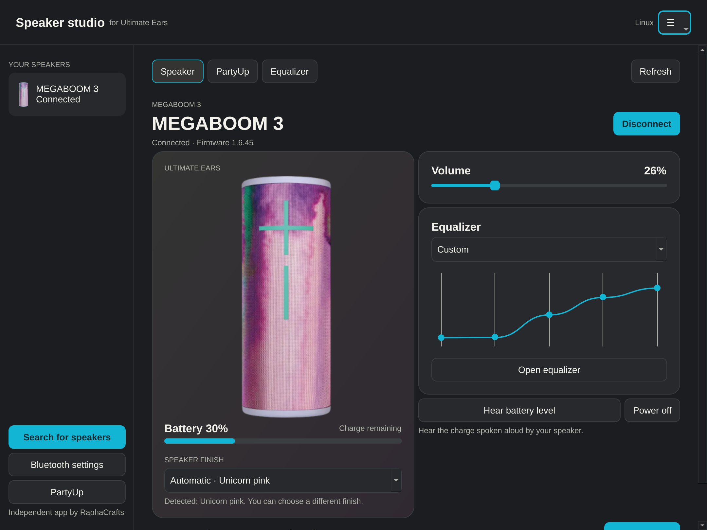

<div align="center">

# Speaker studio
### Your Ultimate Ears speakers, on Linux.

A simple desktop app for checking your speaker, adjusting its sound, and keeping
your music setup in one place.

**No account. No Python installation. No terminal needed to get started.**

[Download the AppImage](https://github.com/RaphaCrafts/Linux-Ultimate-Ears/raw/refs/heads/main/downloads/Speaker-Studio-x86_64.AppImage)

</div>



## Get started

1. **Download** the AppImage using the button above.
2. **Allow it to run.** Right-click the downloaded file, open **Properties →
   Permissions**, and enable **Allow executing file as program** (your desktop
   may call this **Executable as Program**).
3. **Double-click** the AppImage to open Speaker studio.
4. Turn on your speaker and pair it in your desktop's **Bluetooth settings**.
5. Choose your speaker in the app and click **Connect**.

Keep the AppImage wherever you like. On first launch, Speaker studio adds a
shortcut to your app menu with its blue icon; no administrator password is needed.
If you move the file, open it once from its new location to update the shortcut.
The current download is for **64-bit Intel/AMD Linux PCs**, with **Ubuntu 24.04,
Zorin OS 18, or newer** as the baseline. ARM computers are not supported yet.

## What you can do

- See your speaker's battery, connection and current volume.
- Detect known BOOM 3 / MEGABOOM 3 finishes automatically after connecting.
- Use the blue icon in your taskbar and system tray.
- Adjust speaker volume without reaching for your phone.
- Choose a sound profile or adjust five custom EQ bands.
- Power off the speaker from the app; turn it back on using its power button.
- Find your speaker by asking it to announce its battery level.
- Choose from 39 official speaker colour images, or use a neutral **Generic**
  illustration if your finish isn’t listed.
- Keep several connected speakers visible in one app.
- Use the **PartyUp preview** to add or remove compatible connected speakers.

## Colours and the system tray

Choose **Automatic** under **Speaker finish** to use the colour reported by the
speaker. Known BOOM 3 and MEGABOOM 3 colours are mapped to matching artwork.
Unrecognized or unsupported colours use a neutral Generic illustration; you can
choose any finish manually without changing the speaker. Your selection is saved.
Colour detection needs a control connection and does not identify every limited
edition or later-generation speaker.

The tray menu has **Show Speaker studio**, **Hide window**, and **Quit**. Hiding
keeps the app connected; closing the window or choosing Quit exits the app.
Tray availability depends on your desktop. If a tray is unavailable, keep the
app minimized in the taskbar instead.

This is the **first preview release**, focused on **MEGABOOM 3 and BOOM 3**.
MEGABOOM 3 has been tested with a real speaker. Other models and every firmware
version have not been tested. **PartyUp is experimental:** its join/remove
logic is implemented and automatically tested, but still needs a real test
with two speakers. Existing groups may not appear until a speaker sends a group
update. Remote wake, alarms and firmware updates are not included yet.

BOOM 4, MEGABOOM 4, EVERBOOM, EPICBOOM, HYPERBOOM and
WONDERBOOM are not supported for control in this release, even though their
images are included. The app will refuse unsupported model identities.

Your Linux music player and sound settings still choose where music plays.
Speaker studio controls the speaker; it does not replace your music player.

## If something doesn't work

**The AppImage does not open**
Check that the file is allowed to run. If your desktop reports a missing FUSE
library, the same download can run without FUSE. Open a terminal in its folder:

```bash
chmod +x Speaker-Studio-x86_64.AppImage
./Speaker-Studio-x86_64.AppImage --appimage-extract-and-run
```

**My speaker isn't listed**
Turn on Bluetooth and the speaker, move it nearby, then choose **Search for
speakers**. Pair it in your desktop's Bluetooth settings first.

**It is listed but won't connect**
Close the phone's Ultimate Ears app and disconnect the phone from the speaker,
then try again. Make sure the speaker is paired with this computer.

**Music is playing somewhere else**
Select the speaker as the output in your desktop's Sound settings.

**Battery looks rounded**
Speaker studio uses the same stepped battery display convention as the phone
app. It is an estimate rather than a precise measurement.

**An option is unavailable**
Controls are enabled only when supported by the connected speaker and this
release. Features still being validated are not presented as working controls.

Found an issue? [Tell us what happened](https://github.com/RaphaCrafts/Linux-Ultimate-Ears/issues),
including your Linux version, speaker model and app version. Please avoid posting
Bluetooth addresses or other personal information.

## Updating and removing

To update, close the app and replace your AppImage with the new download. To
remove it, delete the file. Appearance preferences are saved locally under your
user configuration folder; deleting the AppImage does not remove those settings.

## Source and project information

The complete source is included in this repository. See [the developer guide](docs/development.md)
if you want to run from source, build an AppImage, or contribute.

Speaker studio is an independent project by **RaphaCrafts**. It is not affiliated
with Logitech or Ultimate Ears. Product images and trademarks belong to their
respective owners. App source is GPL-3.0-or-later; [third-party notices](packaging/THIRD_PARTY_NOTICES.md)
and [image sources](assets/speakers/README.md) are included.

Protocol research is available in [the research notes](docs/protocol-research.md).
Extracted APKs and decompiled vendor code are kept out of this repository.
