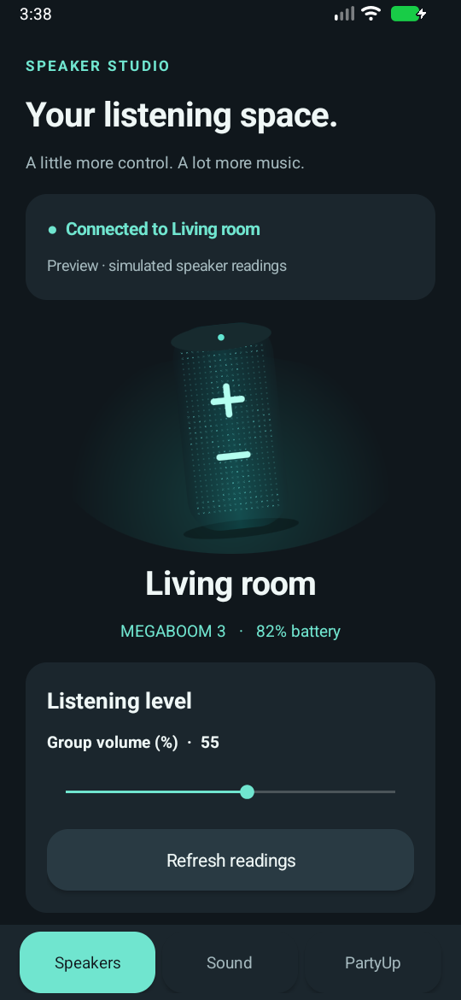
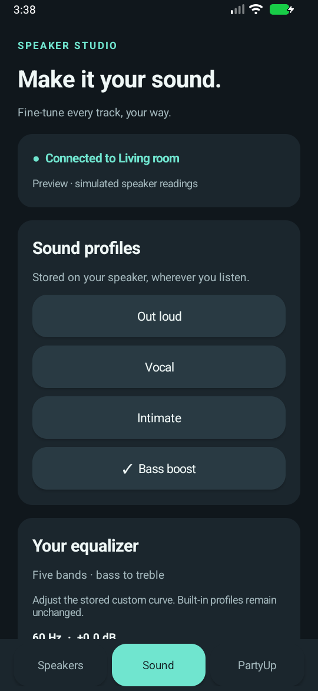

# Speaker Studio for Android

Native Android companion for Speaker Studio, redesigned for a phone in 0.2.0.
A persistent bottom bar switches between **Speakers**, **Sound**, and **PartyUp**.
The teal and ink interface uses original scalable speaker illustrations, readable
cards, and touch controls. No vendor APK code or product photography is bundled.




## Install

Download [Speaker-Studio-Android.apk](../downloads/Speaker-Studio-Android.apk)
to an Android 8.0+ phone and open it. Android may ask you to allow installation
from that browser or file manager. This is a development-signed APK for local
installation, not a Play Store release. Its checksum is in
[SHA256SUMS](../downloads/SHA256SUMS).

1. Turn on the speakers and pair each in Android Bluetooth settings.
2. Connect **media audio to the intended host** in Android's audio controls.
3. Open Speaker Studio, allow Nearby devices, and choose that host.
4. In **PartyUp**, add paired receivers and wait for each confirmed join.
5. Play music from your usual media app. Release controls or leave the app to
   close the control channel while keeping the speaker group playing.

Speaker Studio does not claim or switch the phone's media route. Close other UE
controllers before connecting. If a receiver asks for pairing, press its Bluetooth
button twice and retry. A queued command alone never marks a join successful.

## Controls and desktop parity

| Capability | Android 0.2.0 |
| --- | --- |
| Battery, volume, installed firmware | Read from the connected host; explicit refresh |
| Rename, battery announcement, power off | Implemented with the desktop protocol |
| Built-in sound profiles | Out loud, Vocal, Intimate, Bass boost |
| Custom EQ | Five signed bands; apply and read back on the speaker |
| Saved EQ profiles | Named local copies; built-ins and existing names protected |
| Native PartyUp | Add/remove receivers, end group, Double Up and Stereo |
| Group and individual levels | Host level plus receiver proxy levels where supported |
| Stereo balance | Two confirmed speakers in Stereo; explicit centre button |
| Release controls | Leaves media audio and native PartyUp running |
| Computer Mix | Linux only; requires PipeWire/WirePlumber |
| BLE remote wake | Still Linux only; see below |
| Product finish photographs / desktop tray | Original phone illustration / Android lifecycle |

Unsupported capabilities remain unavailable. Stereo requires exactly one receiver
and a complete inventory from the host; a join event alone cannot prove inventory
completeness. No undocumented inventory request is invented. Individual receiver
sliders appear only after an actual level is returned, and writes wait for a
correlated receiver result and readback. A command timeout closes controls to
prevent late replies being reused. Volume edits hold their pending value until
completion; custom EQ drafts survive tab changes and notifications.

The five-band labels use the desktop's approximate ±12 dB display conversion;
the wire values remain signed bytes. Saved profiles live in app-private preferences.
Firmware installation remains delegated to the official UE | BOOM app, as on Linux.

**Full platform parity is not claimed.** The Linux Computer Mix sends separate
streams through PipeWire. Android's combined audio routing uses privileged system
APIs and is not implemented here. Native PartyUp supplies the phone group playback.
The Linux BLE wake packet includes the local adapter's hardware address, which
requires Android's privileged `LOCAL_MAC_ADDRESS` permission to obtain. Android
wake needs further protocol/hardware research; no guessed address is transmitted.
Use the speaker's power button before connecting on the phone.

Primary targets are **BOOM 3 and MEGABOOM 3**. Original BOOM, BOOM 2 and MEGABOOM
identities are recognized; capability replies gate controls. BOOM 4, MEGABOOM 4,
WONDERBOOM, EVERBOOM, EPICBOOM and HYPERBOOM are outside this implementation.
No maximum receiver count or hardware certification is claimed.

There is no account, network permission, telemetry, background service, or device
address log. Saved pairings stay with Android. Backgrounding or rotation releases
controls; reconnect to read current state. Refresh never starts a group.

## Build and verify

Open this `android` folder in Android Studio with a full JDK 17 or 21, SDK Platform
35 and Build Tools 34.0.0. The wrapper pins Gradle 8.10.2 and AGP 8.7.3.

```sh
./gradlew :app:assembleDebug :app:testDebugUnitTest :app:lintDebug
```

APK: `app/build/outputs/apk/debug/app-debug.apk`. IDE files, SDK paths, build
outputs and signing keys are ignored. No new third-party runtime dependency is
needed for the redesign.

`PreviewInstrumentation` is an emulator-only visual smoke check. It injects a fake
in-memory transport, renders connection / speaker / sound / group views, and saves
PNGs under the test app's external files directory. It never sends Bluetooth
commands and is packaged only in the test APK:

```sh
./gradlew :app:assembleDebugAndroidTest
adb install -r app/build/outputs/apk/debug/app-debug.apk
adb install -r app/build/outputs/apk/androidTest/debug/app-debug-androidTest.apk
adb shell am instrument -w io.raph.speakerstudio.test/io.raph.speakerstudio.PreviewInstrumentation
```

2026-10-24 validation: APK assembly, JVM protocol/control tests and lint pass.
The API 35 target retains an `OldTargetApi` advisory. Emulator screenshots use
**simulated readings**, not a physical speaker connection. No physical Android
phone or Android speaker audio was tested. Group audio, receiver levels, custom
EQ and rename should be checked on a phone before relying on them. Earlier Linux
hardware observations do not establish Android audio behavior or resolve the
previously observed native PartyUp stutter.

Hardware checklist: confirm the phone media route, join a pair, check Double Up,
distinct stereo channels and balance, refresh individual levels, rename and
reconnect, apply/read custom EQ, release controls and listen for dropouts, remove
and rejoin a receiver, reconnect to an existing group, then test three speakers in
Double Up. Also check permission denial, Bluetooth off, a sleeping receiver and an
interrupted command. Keep captures containing addresses under ignored `.local/`.

References: [protocol evidence](../docs/implementation-protocol.md),
[Android Bluetooth permissions](https://developer.android.com/develop/connectivity/bluetooth/bt-permissions),
[combined routing](https://source.android.com/docs/core/audio/combined-audio-routing),
[local adapter address restrictions](https://developer.android.com/reference/android/bluetooth/BluetoothAdapter#getAddress()).

Windows is deferred; see [platform roadmap](../docs/platform-roadmap.md).
The project is GPL-3.0; the unmodified Gradle wrapper is Apache-2.0 licensed.
